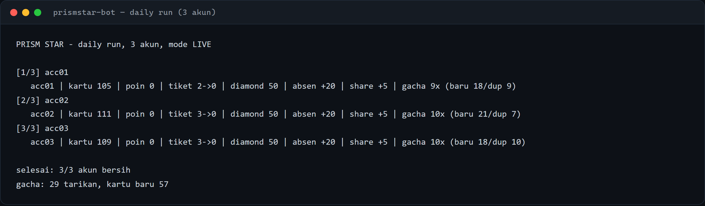

# PrismStar Bot (LYID)

Bot farming otomatis untuk **PRISM STAR** — game card collection Web3 di Telegram
(`@PrismStarGameBot`, backend `app.playprismstar.com`, ekosistem TON + Solana).

Bot ini login sebagai akun Telegram kamu (bukan bot token), ambil `initData` mini app
lewat Telethon, lalu menjalankan rutin harian murni lewat HTTP API — tanpa browser,
tanpa buka Telegram, tanpa modal.

---

## Fitur

| Fitur | Status | Keterangan |
|---|---|---|
| Login initData TWA otomatis | ✅ | Telethon `RequestWebViewRequest`, token valid ~24 jam, digenerate ulang tiap run |
| Onboarding otomatis | ✅ | Set nickname dari username Telegram + accept terms/privacy |
| Klaim absen harian (attendance) | ✅ | +5 tiket/hari, hari 1 dapat bonus new-user +10 tiket |
| Klaim share X harian | ✅ | +5 tiket/hari (client-reported, tidak perlu benar-benar posting) |
| Klaim achievement | ✅ | Otomatis klaim semua achievement yang `claimable` (diamond + tiket) |
| Gacha tiket | ✅ | Mode `ten` (10 tiket) / `single`, tiket dihabiskan sampai batas `min_tickets` |
| Referral / crew | ✅ | Auto accept invite code → invitee +20 tiket, inviter +5 tiket, masuk crew |
| Multi-akun | ✅ | Semua session Telegram yang authorized, delay acak antar akun |
| Battle V2 (stage run) | ❌ v1 | Server replay transkrip gerakan asli; butuh AI aiming. Settle kosong = 0 reward |
| Ads (Monetag/Adsgram) | ❌ | Reward diverifikasi lewat callback jaringan iklan, tidak bisa di-claim dari API |
| Prism Pass / shop | ❌ | Butuh Telegram Stars (berbayar) |

## Cara kerja poin

Skor airdrop/PRISM dihitung dari `finalPrismPoints` (`GET /api/invites/me`):

```
basePrismPoints = cardScore (koleksi kartu) + battleScore
bonus           = koleksi % + saldo PRISM (avg 90 hari) + loyalty days + crew + Prism Pass
```

Praktisnya: **makin banyak kartu unik = makin besar base poin**. Bot ini memaksimalkan
itu dengan mengklaim semua sumber tiket gratis lalu menarik gacha.

## Bukti run (dari bot sendiri, bukan mockup)



Label akun di-mask (`acc01`–`acc03`). Angka di kartu itu hasil sungguhan dari
`data/last-run.txt` — 3 akun, absen +20 dan share +5 tiap akun, 29 tarikan gacha,
57 kartu baru dalam satu run.

## Kebutuhan

| Item | Versi / catatan |
|---|---|
| Python | 3.11+ (`python --version`) |
| Telethon | `pip install telethon` (sudah terpasang di mesin ini) |
| Session Telegram | reuse `~/LYID-BOTS/tg-airdrop-bot/sessions` |
| config Telegram | `~/LYID-BOTS/tg-airdrop-bot/config.json` (berisi `api_id` / `api_hash`) |
| Modal | Rp 0 — semua reward dari tiket gratis |

## Setup

1. Pastikan session Telegram sudah login (kalau belum: `python login.py` di `tg-airdrop-bot`).
2. Cek akun yang hidup:
   ```
   python main.py accounts
   ```
3. Masukkan semua akun aktif ke config:
   ```
   python main.py all
   ```
4. Jalankan:
   ```
   python main.py run
   ```

Atau klik dua kali **JALANKAN.bat** → menu bahasa Indonesia.

## Perintah

```
python main.py                 # menu interaktif
python main.py run             # rutin harian semua akun
python main.py run 6281430     # satu akun (prefix nama session)
python main.py check           # status akun tanpa klaim
python main.py accounts        # daftar session + status login
python main.py add <nama>      # tambah 1 akun ke config
python main.py all             # tambah semua session aktif ke config
```

## Struktur

```
prismstar-bot/
├── config.json        # akun, invite code, pengaturan gacha & delay
├── main.py            # CLI + menu
├── src/
│   ├── twa.py         # Telethon -> initData mini app
│   ├── api.py         # klien HTTP Bearer (retry, error mapping)
│   └── worker.py      # rutin harian per akun
└── data/
    ├── state.json     # snapshot terakhir per akun (kartu, poin, tiket, error)
    └── prismstar.log  # log lengkap
```

## config.json

| Key | Arti |
|---|---|
| `invite_code` | Kode referral yang dipakai semua akun (`PSTAXRUQ` = kode kamu) |
| `actions.*` | Nyalakan/matikan tiap langkah (`attendance`, `x_share`, `gacha`, ...) |
| `gacha.mode` | `ten` (10 tiket sekali tarik) atau `single` |
| `gacha.min_tickets` | Sisakan tiket sebanyak ini (0 = habiskan) |
| `gacha.max_draws_per_run` | Batas tarikan per akun per run (safety) |
| `delays.between_accounts` | Jeda acak antar akun (detik) |
| `delays.between_steps` | Jeda acak antar aksi dalam satu akun |

## API yang dipakai (hasil trace)

```
POST /api/auth/telegram                {initData}                    -> token
POST /api/onboarding/complete          {nickname, terms...}
POST /api/invites/accept               {inviteCode, requestId}
GET  /api/attendance/status
POST /api/reward/attendance            {requestId}
GET  /api/x-share/status
POST /api/x-share/claim                {shareType:"x", requestId}
GET  /api/achievements
POST /api/achievements/claim           {achievementId, requestId}
POST /api/gacha/draw                   {mode:"single"|"ten", currency:"ticket", requestId}
GET  /api/game/state | /api/wallet | /api/invites/me
```

Semua request pakai header `Authorization: Bearer <token>`; tidak ada signing / captcha.

## Troubleshooting

| Gejala | Penyebab & solusi |
|---|---|
| `session ... tidak authorized` | Session Telegram mati / logout. Login ulang di `tg-airdrop-bot`. |
| `webview tanpa fragment` | Bot minta URL lain. Cek `webview_url` di config (`https://app.playprismstar.com/prismstar`). |
| `403 ONBOARDING_REQUIRED` | Onboarding belum jalan — bot otomatis mengurus, pastikan `actions.onboard: true`. |
| `INVALID_GACHA_MODE` | Mode cuma `single` dan `ten`. |
| `crew penuh` | Crew maksimal 30 member; akun tetap farming tanpa crew. |
| `429 SIGNUP_RATE_LIMITED` | **Limit per-IP untuk akun BARU** ("too many new accounts from this network"). Akun yang sudah terdaftar tetap bisa login. Daftarkan bertahap: ~3–4 akun baru per run/hari, atau pakai proxy/WARP saat signup. |
| `429` / lambat | Naikkan `delays.between_accounts`. |
| Tiket 0 padahal baru klaim | Regen tiket 1/jam, cap 10 — normal. |

## Batas pendaftaran akun baru (penting untuk farming banyak akun)

`POST /api/auth/telegram` untuk akun yang **belum pernah** main akan membuat akun baru, dan
endpoint itu dibatasi per-IP:

```
429 SIGNUP_RATE_LIMITED: Too many new accounts have been created from this network.
Existing accounts can still sign in.
```

Artinya di satu IP hanya ~3–4 akun baru yang bisa daftar per jendela waktu. Akun yang sudah
terdaftar tidak terpengaruh. Perilaku bot sekarang (default `signup.max_new_per_run: 0` + `retry_unregistered_hours: 0`):

- Akun yang **sudah terdaftar** selalu dijalankan (cron tiap 4 jam).
- Akun yang pernah kena `SIGNUP_RATE_LIMITED` dicatat di `data/registered.json` dan
  **dilewati tanpa dicoba lagi** — tidak ada spam request.
- Akun baru (belum ada catatan) diprobe sekali; kalau kena limit dicatat dan tidak diulang.
- Mau mencoba daftar lagi? Set `retry_unregistered_hours` (mis. `24`) atau hapus entri akun itu
  di `data/registered.json`. Bisa juga nyalakan WARP/proxy supaya IP-nya berbeda.

## Catatan penting

- Battle stage **tidak** diotomasi di v1: server menjalankan ulang transkrip gerakan
  (seed deterministik) dan settle dengan transkrip kosong menghasilkan 0 gold/0 poin.
  Kalau mau mengejar `battleScore`, harus ada bot yang benar-benar memainkan run
  (aim + upgrade + core) — kandidat v1.1.
- Iklan (3 tiket + 1 growth point per hari) diverifikasi lewat callback Monetag,
  jadi tidak bisa diklaim dari API — buka game manual kalau mau ambil bagian itu.
- Bot tidak menyimpan password/OTP. Yang disimpan hanya token API di memori (tidak
  ditulis ke disk) dan snapshot statistik di `data/state.json`.
